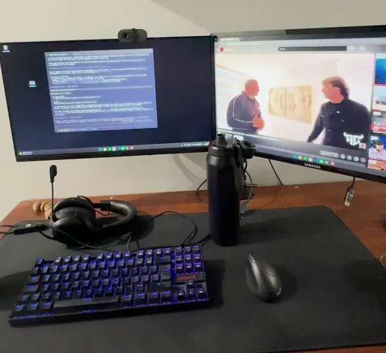

# LockMirror

Show the Windows lock screen on **all** your monitors, not just the primary one.



With two or more monitors in *Extend* mode, Windows 10 and 11 show the lock screen only on the primary display and leave the others black. LockMirror is a tiny background app that fixes that:

- **On lock**, it remembers where every window is and switches the displays to *Duplicate*, so the lock screen appears on every monitor.
- **On unlock**, it switches back to *Extend* and puts any window that Windows moved back where it was.

No admin rights, no services, no scheduled tasks, no audit policy changes. It's a single ~170 KB executable that listens for the session lock and unlock notifications Windows already sends to apps.

## Requirements

- Windows 10 or 11 (x64)
- [.NET 9 Desktop Runtime](https://dotnet.microsoft.com/download/dotnet/9.0)

## Install

1. Download `LockMirror.exe` from the [latest release](../../releases/latest) and put it somewhere permanent, for example `%LOCALAPPDATA%\Programs\LockMirror\`.
2. Run it once. It has no window: it just stays in the background (you'll see it in Task Manager).

   > Windows may show a blue **"Windows protected your PC"** warning the first time. That's SmartScreen: it shows up for any program downloaded from the internet that isn't code-signed and hasn't been downloaded by many people yet. Click **More info → Run anyway**. If you'd rather not trust a downloaded executable, read `Program.cs` and [build it yourself](#build).

3. To start it automatically when you sign in:

   ```powershell
   & "$env:LOCALAPPDATA\Programs\LockMirror\LockMirror.exe" --install
   ```

That's it. Lock with <kbd>Win</kbd>+<kbd>L</kbd> to try it.

## Uninstall

```powershell
& "$env:LOCALAPPDATA\Programs\LockMirror\LockMirror.exe" --uninstall
Stop-Process -Name LockMirror
```

Then delete the executable and, optionally, the log folder `%LOCALAPPDATA%\LockMirror`.

`--install` only adds a `LockMirror` value under `HKCU\Software\Microsoft\Windows\CurrentVersion\Run`, and `--uninstall` removes it. Nothing else on the system is changed.

## How it works

- A hidden window registers for session notifications with `WTSRegisterSessionNotification`.
- On `WTS_SESSION_LOCK` it saves every visible window's placement and calls `SetDisplayConfig` with `SDC_TOPOLOGY_CLONE`. The lock notification arrives slightly before Windows allows display changes, so the first attempt usually fails with *access denied*. It retries every 500 ms, up to 5 times.
- On `WTS_SESSION_UNLOCK` it calls `SetDisplayConfig` with `SDC_TOPOLOGY_EXTEND`, which brings back your last extended layout. It then restores any window whose position changed, in two passes (after 1 s and 3 s), without stealing focus.
- If only one monitor is active when you lock, it does nothing.

It logs each lock and unlock to `%LOCALAPPDATA%\LockMirror\log.txt`. The file is reset when it passes 256 KB.

## Limitations

- Every monitor shows the same image while locked. If your monitors have different resolutions, it may be scaled or letterboxed on one of them.
- It takes a second or two after unlocking for the displays to switch back to *Extend*.
- If LockMirror is closed while the screen is locked, the displays stay duplicated after you unlock. Press <kbd>Win</kbd>+<kbd>P</kbd> and choose *Extend*.

## Build

```powershell
dotnet publish -c Release -o publish
```

The executable ends up in `publish\LockMirror.exe`. Requires the .NET 9 SDK.

## Alternatives

- [Wintermelon](https://github.com/arun-goud/Wintermelon) uses the same duplicate-on-lock idea, but it reacts to security audit events through scheduled tasks. It needs admin rights, turns on an audit policy and targets .NET Core 3.1.
- [win11-lockscreen-wallpaper](https://github.com/Microzello/win11-lockscreen-wallpaper) leaves the displays extended and draws your own wallpaper over the black monitors instead. You can show a different image on each monitor and the windows never move, but drawing above the lock screen requires `uiAccess`. To get it, the installer adds a self-signed certificate to the machine's Trusted Root store and installs the app under `Program Files` with admin rights. The overlay also disappears whenever Windows switches to the secure sign-in desktop.

## Credits

Inspired by [Wintermelon](https://github.com/arun-goud/Wintermelon), which first used the duplicate-on-lock approach.

## License

[MIT](LICENSE)
